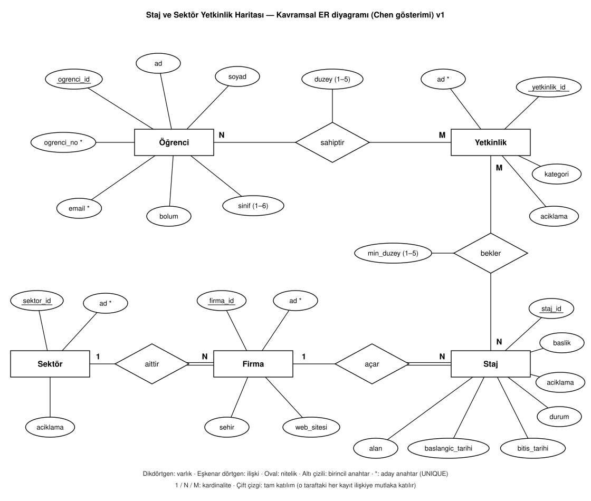

# Staj ve Sektör Yetkinlik Haritası

**Yazılım Geliştirme — Proje 2 · Grup 1**

Öğrencilerin yetkinliklerini, firmaların staj pozisyonlarında beklediği yetkinliklerle karşılaştıran web uygulaması. Projenin odağı arayüz değil; doğru veri modeli, veri bütünlüğü, CRUD işlemleri, JOIN sorguları ve karar vermeyi destekleyen raporlardır.

---

## İçindekiler

- [Proje amacı](#proje-amacı)
- [Ekip ve roller](#ekip-ve-roller)
- [Kullanılan teknolojiler](#kullanılan-teknolojiler)
- [Klasör yapısı](#klasör-yapısı)
- [Kurulum](#kurulum)
- [Veritabanı özeti](#veritabanı-özeti)
- [ER diyagramı](#er-diyagramı)
- [Örnek veri](#örnek-veri)
- [Belgeler](#belgeler)
- [Çalışma kuralları](#çalışma-kuralları)

---

## Proje amacı

Sistem üç tür kullanıcının ihtiyacına cevap verir:

| Kullanıcı | İhtiyaç |
|---|---|
| Öğrenci | Kendi yetkinliklerini ve düzeylerini kaydetmek, staj beklentileriyle karşılaştırmak |
| Staj koordinatörü / danışman | Öğrencilerin güçlü ve eksik oldukları yetkinlikleri toplu olarak görmek |
| Firma / sektör temsilcisi | Bir staj pozisyonu için beklenen yetkinlikleri ve minimum düzeyleri tanımlamak |

Temel işlevler:

- Öğrenci, firma, sektör, staj ve yetkinlik kayıtları için CRUD
- Öğrenci yetkinlikleri ve staj pozisyonlarının beklediği yetkinlikler (1–5 düzey)
- **Yetkinlik boşluğu analizi:** seçilen öğrenci ile pozisyon karşılaştırılır; eşleşen ve eksik yetkinlikler listelenir
- Teknoloji, alan, firma, yetkinlik ve düzeye göre filtreleme
- Raporlar (ör. en çok talep edilen yetkinlikler, öğrenci–yetkinlik boşlukları)

## Ekip ve roller

Tüm üyeler esas rollerinin yanında geliştiricidir ve kod/SQL katkısı üretir.

| Üye | Esas rol | Sorumluluk |
|---|---|---|
| Berkant Aydın | Lider | Kapsam, issue/PR yönetimi, koordinasyon, teslim |
| Hilal Akça | Analist | Paydaş analizi, gereksinimler, veri sözlüğü, kabul kriterleri |
| Selin Özbay | Test/Kalite | Test planı, veri bütünlüğü testleri, negatif testler |
| Çağrı Aydemir | Dokümantasyon/Sunum | ER, kurulum kılavuzu, teknik rapor, kullanıcı kılavuzu, demo |

## Kullanılan teknolojiler

| Katman | Teknoloji |
|---|---|
| Frontend | HTML, CSS, JavaScript |
| Backend | PHP |
| Veritabanı | MySQL 8 / MariaDB (XAMPP) |
| Veritabanı bağlantısı | PHP PDO (hazırlanmış sorgular) |
| Yerel geliştirme | XAMPP (Apache + PHP + MariaDB) |
| Veritabanı yönetimi | phpMyAdmin |

Seçimlerin gerekçesi için: [docs/teknoloji-karari.md](docs/teknoloji-karari.md)

## Klasör yapısı

```
.
├── docs/
│   ├── teknoloji-karari.md      Teknoloji seçimi ve çalışma kuralları
│   ├── kullanici-senaryolari.md Personalar, kullanıcı hikâyeleri, senaryolar
│   ├── gereksinimler.md         Fonksiyonel / fonksiyonel olmayan gereksinimler
│   ├── veri-sozlugu.md          Tablolar, alanlar, kısıtlar
│   ├── test-plani.md            Test planı ve test senaryoları
│   └── er/
│       ├── er-diyagrami-v1.md           ER açıklaması + mantıksal ER (Mermaid)
│       └── er-kavramsal-chen.drawio.svg Kavramsal ER (Chen) görseli
├── sql/
│   └── schema-taslak.sql    Veritabanı şeması (taslak, Hafta 2'de kesinleşecek)
├── src/
│   ├── config.php           Ayarları .env dosyasından okur
│   └── db.php               PDO bağlantısı: db() fonksiyonu
├── public/                  Tarayıcıdan erişilen sayfalar
│   ├── index.php            Ana sayfa
│   └── baglanti-testi.php   Veritabanı bağlantı testi
├── data/
│   └── seed-taslak/         Sentetik örnek veri (tablo başına bir CSV)
├── .env.example             Ayar şablonu
└── .gitignore
```

## Kurulum

### Gereksinimler

- [XAMPP](https://www.apachefriends.org/) (Apache, PHP 8 ve MariaDB içerir)
- Git veya GitHub Desktop

### 1. XAMPP'ı başlatın

XAMPP Control Panel'i açın ve **Apache** ile **MySQL** satırlarında **Start**'a basın. İkisi de yeşil görünmelidir.

### 2. Projeyi `htdocs` klasörüne klonlayın

Apache yalnızca XAMPP'ın `htdocs` klasöründeki dosyaları sunar. Projeyi oraya klonlayın:

```
C:\xampp\htdocs\yg-proje2-grup1
```

Komut satırıyla:

```bash
cd C:\xampp\htdocs
git clone https://github.com/berkantaydn/yg-proje2-grup1.git
```

GitHub Desktop kullanıyorsanız: **File → Clone repository** menüsünde **Local path** alanına `C:\xampp\htdocs\yg-proje2-grup1` yazın.

### 3. `.env` dosyasını oluşturun

Proje kökündeki `.env.example` dosyasını kopyalayın ve kopyanın adını `.env` yapın. XAMPP varsayılan ayarlarıyla (kullanıcı `root`, şifre boş) içeriği değiştirmeye gerek yoktur.

```
DB_HOST=127.0.0.1
DB_PORT=3306
DB_NAME=staj_yetkinlik
DB_USER=root
DB_PASS=
```

> `.env` dosyası `.gitignore` içinde yer alır ve GitHub'a gönderilmez. Gerçek şifreler asla commit'lenmez.

### 4. Veritabanı şemasını içe aktarın

1. Tarayıcıda `http://localhost/phpmyadmin` adresini açın.
2. Sol menüden **herhangi bir veritabanı seçmeden**, üst menüdeki **İçe Aktar (Import)** sekmesine girin.
3. **Dosya seç** ile `sql/schema-taslak.sql` dosyasını seçin ve sayfanın altındaki **İçe Aktar**'a basın.

Dosya `staj_yetkinlik` veritabanını kendisi oluşturur ve 7 tabloyu kurar.

> **Uyarı:** Betik `DROP TABLE IF EXISTS` kullanır. Tekrar içe aktarmak tabloları silip yeniden kurar, içlerindeki veriler kaybolur.

### 5. Bağlantıyı test edin

Tarayıcıda şu adresi açın:

```
http://localhost/yg-proje2-grup1/public/baglanti-testi.php
```

Kurulum doğruysa yeşil kutuda **"Veritabanı bağlantısı başarılı."** yazar ve 7 tablo listelenir.

### Sorun giderme

| Belirti | Olası neden ve çözüm |
|---|---|
| Sayfa açılmıyor / "Not Found" | Apache çalışmıyor ya da proje `htdocs` altında değil. Klasör yolunu ve adres çubuğundaki klasör adını kontrol edin. |
| `Connection refused` veya `No such file or directory` | MySQL çalışmıyor. XAMPP Control Panel'den MySQL'i başlatın. |
| `Unknown database 'staj_yetkinlik'` | Şema içe aktarılmamış. 4. adımı tekrarlayın. |
| `Access denied for user 'root'` | MySQL root şifresi boş değil. `.env` içindeki `DB_PASS` değerini güncelleyin. |
| MySQL başlamıyor (port 3306 dolu) | Bilgisayarda başka bir MySQL çalışıyor. Onu durdurun ya da XAMPP'ın portunu değiştirip `.env` içindeki `DB_PORT` değerini aynı yapın. |

## Veritabanı özeti

Şema taslağı `sql/schema-taslak.sql` dosyasındadır. Kesin sürüm Hafta 2'de (P2-06, P2-08) yazılacaktır.

| Tablo | Açıklama | İlişkiler |
|---|---|---|
| `sektor` | Sektörler (ör. Yazılım, Finans) | — |
| `yetkinlik` | Yetkinlik / teknoloji sözlüğü | — |
| `ogrenci` | Öğrenci profili | — |
| `firma` | Staj veren firmalar | `sektor`'e bağlı (N:1) |
| `staj` | Firmanın açtığı staj pozisyonu | `firma`'ya bağlı (N:1) |
| `ogrenci_yetkinlik` | Öğrencinin yetkinlikleri ve düzeyi (1–5) | `ogrenci` ↔ `yetkinlik` **çoktan çoğa** |
| `staj_yetkinlik` | Pozisyonun beklediği yetkinlikler ve minimum düzey (1–5) | `staj` ↔ `yetkinlik` **çoktan çoğa** |

Veri bütünlüğü kısıtlardan bazıları:

- Tüm tablolarda birincil anahtar; ilişkilerde yabancı anahtar (FK)
- Sektör, yetkinlik ve firma adları, öğrenci numarası ve e-posta tekrarlanamaz (`UNIQUE`)
- Yetkinlik düzeyleri 1–5 arasında olmak zorundadır (`CHECK`)
- Staj bitiş tarihi başlangıç tarihinden önce olamaz
- Kullanımdaki bir yetkinlik veya sektör silinemez (`ON DELETE RESTRICT`); bir firma silindiğinde stajları da silinir (`ON DELETE CASCADE`)

## ER diyagramı

Kavramsal ER diyagramı (Chen gösterimi):



Tablo, anahtar ve kardinalite düzeyindeki **mantıksal ER diyagramı** (kaz ayağı gösterimi), iki diyagram arasındaki dönüşüm kuralları ve anahtar adayları için: [docs/er/er-diyagrami-v1.md](docs/er/er-diyagrami-v1.md)

## Örnek veri

`data/seed-taslak/` klasöründe her tablo için bir CSV dosyası vardır: 4 sektör, 12 yetkinlik, 9 öğrenci, 6 firma ve 8 staj. Tüm kayıtlar sentetiktir; gerçek kişi veya firma verisi içermez. Veri, kullanıcı senaryolarındaki yetkinlik boşluğu örneğini (KS-03) ve raporları gösterebilecek şekilde tasarlanmıştır.

phpMyAdmin ile yükleme sırası ve verinin hangi durumları test ettiği: [data/seed-taslak/README.md](data/seed-taslak/README.md)

> Kesin `seed.sql` dosyası P2-08 kapsamında hazırlanacaktır.

## Belgeler

| Belge | İçerik | Görev |
|---|---|---|
| [Teknoloji kararı](docs/teknoloji-karari.md) | Seçilen teknolojiler, gerekçeler, çalışma kuralları | P2-05 |
| [Kullanıcı senaryoları](docs/kullanici-senaryolari.md) | Personalar, kullanıcı hikâyeleri, temel senaryolar | P2-01 |
| [Gereksinimler](docs/gereksinimler.md) | Fonksiyonel ve fonksiyonel olmayan gereksinimler, kabul kriterleri | P2-02 |
| [Veri sözlüğü](docs/veri-sozlugu.md) | Tablolar, alanlar, veri tipleri, kısıtlar, ilişkiler | P2-03 |
| [ER diyagramı v1](docs/er/er-diyagrami-v1.md) | Kavramsal ve mantıksal ER, kardinaliteler, anahtar adayları | P2-04 |
| [Test planı](docs/test-plani.md) | Test türleri, veri tabanı kısıt testleri, negatif testler | P2-04 |
| [Örnek veri](data/seed-taslak/README.md) | Sentetik veri, yükleme sırası, test edilen durumlar | #3 |

## Çalışma kuralları

1. Herkes kendi dalında (`feature/...`) çalışır ve Pull Request ile `main`'e birleştirir.
2. Her commit mesajında görev kodu ve issue numarası olur. Örnek: `P2-03: veri sözlüğü eklendi (#2)`
3. `.env` dosyası asla commit'lenmez; şablon `.env.example`'dır.
4. Kullanıcıdan gelen veri SQL metnine doğrudan eklenmez; PDO `prepare()` + `execute()` kullanılır.
5. Gerçek kişi verisi kullanılmaz; tüm örnek veriler sentetik/anonimdir.
