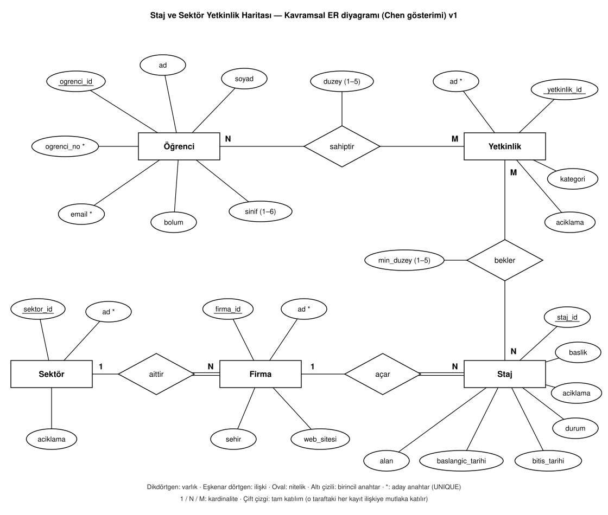
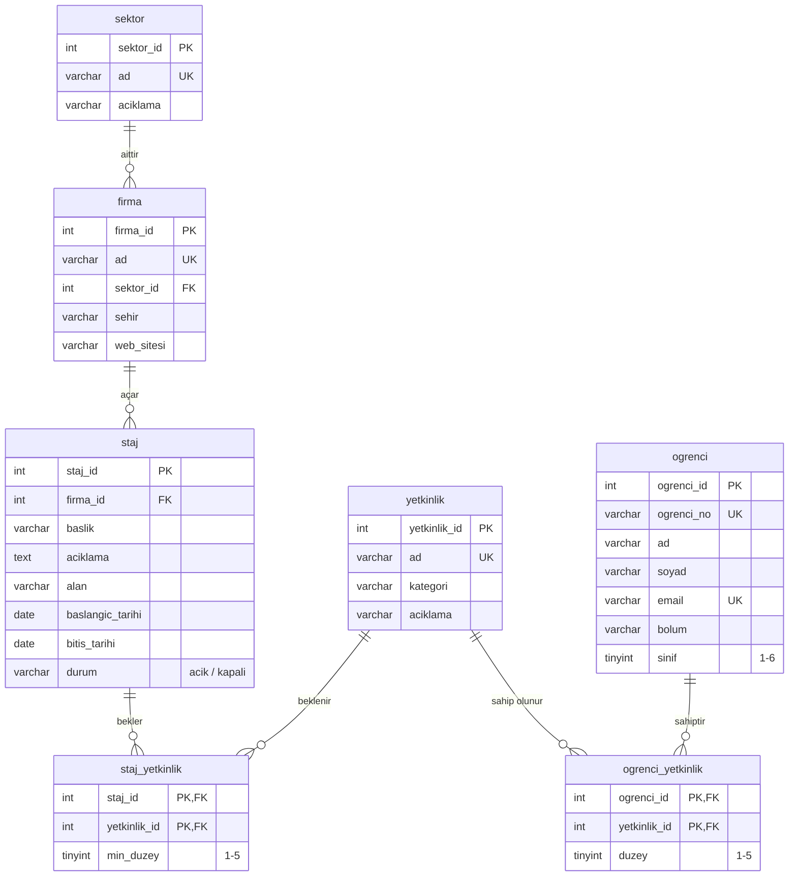

# Staj ve Sektör Yetkinlik Haritası

## P2-04 — ER Diyagramı v1

**Görev:** Issue #1 · **Rol:** Test/Kalite · **Hazırlayan:** Selin Özbay  
**Sürüm:** 1.0 — `sql/schema-taslak.sql` ve `docs/veri-sozlugu.md` (sürüm 1.1) temel alınmıştır

## 1. İki diyagram, iki seviye

Veri modeli iki adımda gösterilmiştir:

| | Kavramsal ER (Bölüm 2) | Mantıksal ER (Bölüm 4) |
|---|---|---|
| Soru | Hangi varlıklar var, birbirleriyle nasıl ilişkili? | Veri tabanında hangi tablolar ve anahtarlar olacak? |
| Gösterim | Chen (dikdörtgen, oval, eşkenar dörtgen) | Kaz ayağı (crow's foot) |
| Çoktan çoğa ilişki | Doğrudan çizilir (N — M) | Ara tabloya bölünür |
| Yabancı anahtar (FK) | Yoktur | Gösterilir |
| Dosya | [`er-kavramsal-chen.drawio.svg`](er-kavramsal-chen.drawio.svg) | Bölüm 4'teki Mermaid kodu |

Önce kavramsal model çizilmiş, ardından Bölüm 3'teki kurallarla tablolara (mantıksal modele) dönüştürülmüştür.

## 2. Kavramsal ER diyagramı (Chen gösterimi)

Dosya hem resim hem de **draw.io belgesidir**: [draw.io](https://app.diagrams.net) (veya VS Code'daki Draw.io Integration eklentisi) ile açılıp düzenlenebilir, kaydedilince GitHub'daki görüntü de güncellenir.

### Gösterim

| Şekil | Anlamı | Diyagramdaki örnek |
|---|---|---|
| Dikdörtgen | Varlık | Öğrenci, Staj |
| Eşkenar dörtgen | İlişki | sahiptir, açar |
| Oval | Nitelik (alan) | `soyad`, `alan` |
| Altı çizili oval | Birincil anahtar | `ogrenci_id` |
| `*` işaretli oval | Diğer aday anahtar (UNIQUE) | `ogrenci_no *`, `email *` |
| İlişki dörtgenine bağlı oval | İlişkinin kendi niteliği | `duzey`, `min_duzey` |
| 1 / N / M | Kardinalite | Firma **1** — açar — **N** Staj |
| Çift çizgi | Tam katılım: o taraftaki her kayıt ilişkiye mutlaka katılır | Her firma bir sektöre, her staj bir firmaya aittir |

### İlişkiler

| İlişki | Kardinalite | Katılım | İlişkinin niteliği |
|---|---|---|---|
| Öğrenci — **sahiptir** — Yetkinlik | N : M | İki taraf da kısmi (yetkinliği olmayan öğrenci, kimsede olmayan yetkinlik olabilir) | `duzey` (1–5) |
| Staj — **bekler** — Yetkinlik | N : M | İki taraf da kısmi | `min_duzey` (1–5) |
| Firma — **açar** — Staj | 1 : N | Staj tarafı **tam** (firmasız staj olamaz) | — |
| Sektör — **aittir** — Firma | 1 : N | Firma tarafı **tam** (sektörsüz firma olamaz) | — |

`duzey` ne öğrenciye ne yetkinliğe aittir; "bu öğrencinin bu yetkinlikteki düzeyi" olduğu için **ilişkinin** niteliğidir. Bu yüzden Chen diyagramında sahiptir dörtgenine bağlanmıştır. `min_duzey` için de aynısı geçerlidir.

Kavramsal modelde FK yoktur: Firma'nın `sektor_id` alanı, Staj'ın `firma_id` alanı burada nitelik olarak çizilmez; bu bağlantıları ilişki dörtgenleri gösterir.

## 3. Kavramsal modelden tablolara dönüşüm

| Kavramsal modelde | Tablolarda (mantıksal model) | Uygulanan kural |
|---|---|---|
| Varlıklar: Öğrenci, Yetkinlik, Staj, Firma, Sektör | `ogrenci`, `yetkinlik`, `staj`, `firma`, `sektor` | Her varlık bir tablo olur; altı çizili nitelik birincil anahtar olur. |
| Sektör **1 : N** Firma (aittir) | `firma.sektor_id` → FK | 1:N ilişkide "1" tarafının anahtarı "N" tarafına FK olarak eklenir. Firma tarafı tam katılımlı olduğu için alan `NOT NULL`. |
| Firma **1 : N** Staj (açar) | `staj.firma_id` → FK | Aynı kural; staj tam katılımlı olduğu için `NOT NULL`. |
| Öğrenci **N : M** Yetkinlik (sahiptir) + `duzey` | `ogrenci_yetkinlik` (`ogrenci_id`, `yetkinlik_id`, `duzey`) | N:M ilişki kendi tablosu olur. İki tarafın anahtarları FK ve birlikte bileşik PK olur; ilişkinin niteliği bu tabloya taşınır. |
| Staj **N : M** Yetkinlik (bekler) + `min_duzey` | `staj_yetkinlik` (`staj_id`, `yetkinlik_id`, `min_duzey`) | Aynı kural. |
| `*` işaretli aday anahtarlar | `UNIQUE` kısıtları | Seçilmeyen aday anahtarlar tekrar etmesin diye UNIQUE ile korunur. |
| Değer aralıkları (1–5, 1–6) | `CHECK` kısıtları | Kavramsal kural, veri tabanında kısıtla zorlanır. |

5 varlık + 2 çoktan çoğa ilişki = **7 tablo**. Teknik dokümandaki önerilen varlıklar listesinde yer alan "ÖğrenciYetkinlik" ve "PozisyonYetkinlik", bu dönüşümde ortaya çıkan ara tablolardır.

## 4. Mantıksal ER diyagramı (kaz ayağı gösterimi)

Mermaid koduyla yazılmıştır; GitHub bu kodu otomatik olarak diyagram olarak çizer. Düzenlemek veya PNG/SVG olarak dışa aktarmak için kod [mermaid.live](https://mermaid.live) sitesine yapıştırılabilir.

### Gösterim

| Simge | Anlamı |
|---|---|
| `PK` | Birincil anahtar (primary key): satırı tek başına tanımlayan alan |
| `FK` | Yabancı anahtar (foreign key): başka tablodaki bir satıra bağlanan alan |
| `UK` | Benzersiz alan (UNIQUE): tabloda iki kez aynı değeri alamaz |

Kaz ayağı gösteriminde çizginin ucundaki simge kardinaliteyi verir. Dört uç vardır:

| Uç | Anlamı | (en az, en çok) | Bu diyagramda |
|---|---|---|---|
| <code>&#124;&#124;</code> | Tam olarak bir | (1, 1) | Üst tablo ucu (ör. her firma tam olarak bir sektöre bağlı) |
| <code>o&#124;</code> | Sıfır ya da bir | (0, 1) | Kullanılmadı |
| <code>&#124;{</code> | Bir ya da çok | (1, N) | Kullanılmadı |
| `o{` | Sıfır ya da çok | (0, N) | Alt tablo ucu (ör. bir sektörün firması hiç olmayabilir ya da çok olabilir) |

**Okuma kuralı:** Tabloya bitişik simge en çoğu, ondan sonraki en azı gösterir (çizgi = bir, daire = sıfır, kaz ayağı = çok). Uçtaki simge, karşı taraftaki tek bir kaydın bu taraftaki kaç kayıtla eşleştiğini söyler; yani karşıdan bakarak okunur.

Örnek okuma: `sektor ||--o{ firma` → "Bir sektör sıfır ya da çok (0, N) firmayla eşleşir; bir firma tam olarak bir (1, 1) sektörle eşleşir."

Alanların veri tipleri ve kısıtları [veri sözlüğünde](../veri-sozlugu.md) ayrıntılı olarak verilmiştir.

### Tablolar

| Tablo | Türü | Ne tutar? |
|---|---|---|
| `sektor` | Ana tablo | Sektörler (Yazılım, Finans ...) |
| `firma` | Ana tablo | Staj veren firmalar |
| `staj` | Ana tablo | Firmanın açtığı staj pozisyonu |
| `yetkinlik` | Ana tablo | Ortak yetkinlik / teknoloji sözlüğü (SQL, PHP ...) |
| `ogrenci` | Ana tablo | Sentetik öğrenci profilleri |
| `ogrenci_yetkinlik` | Ara tablo | Hangi öğrencinin hangi yetkinliğe hangi düzeyde sahip olduğu |
| `staj_yetkinlik` | Ara tablo | Hangi stajın hangi yetkinliği hangi minimum düzeyde beklediği |

## 5. İlişkiler ve kardinaliteler (tablo düzeyi)

| # | İlişki | Üst uç | Alt uç | Okunuşu | FK | Silme kuralı |
|---|---|---|---|---|---|---|
| R1 | sektor — firma | (1, 1) | (0, N) | Bir sektörün sıfır ya da çok firması olur; her firma tam olarak bir sektöre aittir. | `firma.sektor_id` | RESTRICT |
| R2 | firma — staj | (1, 1) | (0, N) | Bir firma sıfır ya da çok staj açar; her staj tam olarak bir firmaya aittir. | `staj.firma_id` | CASCADE |
| R3 | ogrenci — ogrenci_yetkinlik | (1, 1) | (0, N) | Bir öğrencinin sıfır ya da çok yetkinlik kaydı olur. | `ogrenci_yetkinlik.ogrenci_id` | CASCADE |
| R4 | yetkinlik — ogrenci_yetkinlik | (1, 1) | (0, N) | Bir yetkinlik sıfır ya da çok öğrencide bulunur. | `ogrenci_yetkinlik.yetkinlik_id` | RESTRICT |
| R5 | staj — staj_yetkinlik | (1, 1) | (0, N) | Bir staj sıfır ya da çok yetkinlik bekler. | `staj_yetkinlik.staj_id` | CASCADE |
| R6 | yetkinlik — staj_yetkinlik | (1, 1) | (0, N) | Bir yetkinlik sıfır ya da çok stajda beklenir. | `staj_yetkinlik.yetkinlik_id` | RESTRICT |

Alt uçta **sıfır ya da çok (0, N)** seçilmesinin nedeni: yeni eklenen bir sektörün henüz firması, yeni bir öğrencinin henüz yetkinliği olmayabilir. Üst uçta ise bütün FK alanları `NOT NULL` olduğu için bağlı kaydın üst kaydı her zaman **tam olarak bir (1, 1)** tanedir.

**Sektör ile staj** arasında doğrudan bağlantı yoktur. Bir stajın sektörü, firması üzerinden bulunur (`staj → firma → sektor`). Sektörü staja ayrıca yazmak aynı bilgiyi iki yerde tutmak olurdu (3NF'ye aykırı).

Yetkinlik boşluğu analizi (FR-09), iki ara tablonun aynı `yetkinlik_id` üzerinden karşılaştırılmasıyla yapılır.

## 6. Anahtar adayları

**Aday anahtar**, bir satırı tek başına tanımlayabilen alan veya alan grubudur. Adaylardan biri birincil anahtar seçilir; diğerleri `UNIQUE` kısıtıyla korunur.

| Tablo | Aday anahtarlar | Seçilen PK | Diğer adaylar nasıl korunuyor? |
|---|---|---|---|
| `sektor` | `sektor_id`, `ad` | `sektor_id` | `ad` → UNIQUE |
| `firma` | `firma_id`, `ad` | `firma_id` | `ad` → UNIQUE |
| `yetkinlik` | `yetkinlik_id`, `ad` | `yetkinlik_id` | `ad` → UNIQUE |
| `ogrenci` | `ogrenci_id`, `ogrenci_no`, `email` | `ogrenci_id` | `ogrenci_no`, `email` → UNIQUE |
| `staj` | `staj_id` | `staj_id` | Doğal aday anahtar yok (bkz. Bölüm 7) |
| `ogrenci_yetkinlik` | (`ogrenci_id`, `yetkinlik_id`) | Bileşik PK | — |
| `staj_yetkinlik` | (`staj_id`, `yetkinlik_id`) | Bileşik PK | — |

**Neden yapay (`_id`) birincil anahtar?** Ad veya öğrenci numarası ileride değişebilir. Değişmeyen bir sayı PK olunca, bu değişiklik bağlı tablolardaki FK'ları etkilemez.

**Ara tablolarda bileşik PK:** `(ogrenci_id, yetkinlik_id)` çiftinin PK olması, aynı öğrenciye aynı yetkinliğin iki kez eklenmesini veri tabanı düzeyinde engeller (test planında DB-15, DB-16).

## 7. Ekibe notlar (şema v1 öncesi)

- **`staj` tablosunun doğal aday anahtarı yok.** Aynı firma aynı başlıkla aynı tarihlerde ikinci bir staj açabilir. Bu bilinçli bir tercih olabilir; istenmiyorsa (`firma_id`, `baslik`, `baslangic_tarihi`) için UNIQUE eklenebilir. P2-06'da karar verilmeli.
- **Firma silinince stajlar da silinir (CASCADE).** Sektör ve yetkinlikte ise silme engellenir (RESTRICT). Bu fark diyagramlardan görünmez; Bölüm 5'teki tabloda belirtilmiştir.
- Teknik dokümanda isteğe bağlı önerilen **Proje/Deneyim** ve **Değerlendirme/Seviye geçmişi** varlıkları v1'de yoktur. Kapsam genişletilirse ER v2'de eklenebilir.
- İki diyagram da `schema-taslak.sql` ile birebir uyumludur. Şema v1 (P2-06) değişirse ikisi birlikte güncellenmelidir: Chen diyagramı draw.io'da, mantıksal diyagram Bölüm 4'teki Mermaid kodunda.

## 8. Kaynaklar

- `sql/schema-taslak.sql`, [`veri-sozlugu.md`](../veri-sozlugu.md), [`gereksinimler.md`](../gereksinimler.md)
- Proje 2 Teknik Proje Dokümanı, bölüm 5 ve 6; Dört Haftalık Eylem Planı, P2-04
- GitHub Issue #1

## 9. Sürüm geçmişi

| Sürüm | Değişiklik |
|---|---|
| 1.0 | İlk sürüm: kavramsal ER (Chen, draw.io) ve mantıksal ER (kaz ayağı, Mermaid); kardinaliteler, katılım, 2 çoktan çoğa ilişki ve ara tabloları, kavramsaldan tablolara dönüşüm, anahtar adayları. |
